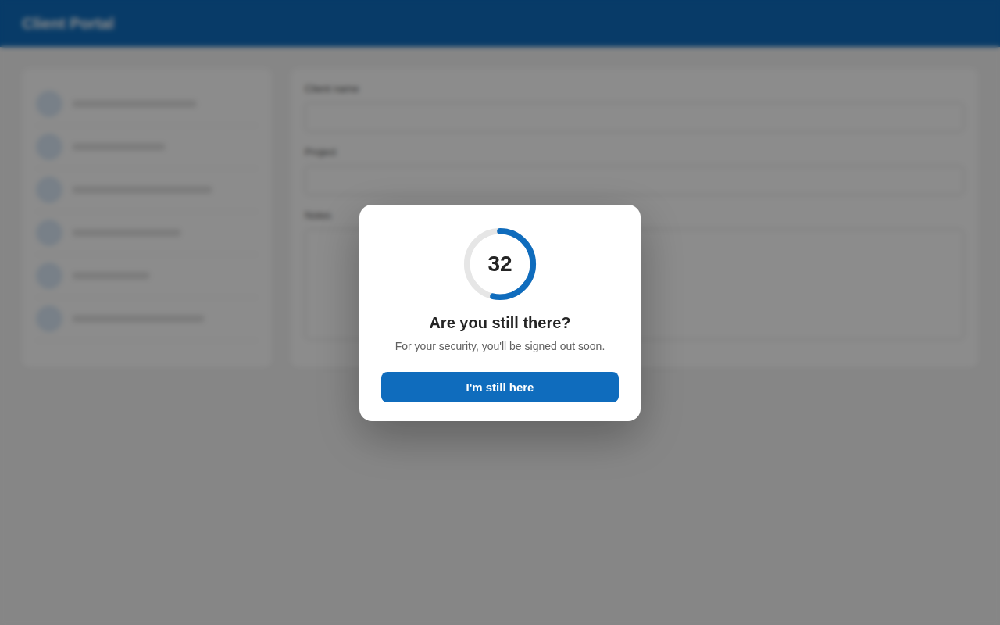

# Idle Session Guard

A Power Apps code component (PCF) for **canvas apps** that detects user inactivity, shows an "Are you still there?" warning with a countdown, and lets your app sign the user out, lock the screen or save a draft when time runs out.

Canvas apps have no built-in way to detect inactivity. Resetting a Timer in every control's `OnSelect` misses scrolling, typing and mouse movement, and breaks when the device sleeps. Idle Session Guard listens to the whole app with one control and measures real clock time.



## Features

- Detects mouse movement, clicks, key presses, touch, wheel and scroll anywhere in the app
- Built-in warning dialog with an animated countdown ring (can be turned off)
- Uses real clock time, so sleep, locked devices and background tabs are handled correctly
- Once idle, stays idle until the app resets it, so a stray mouse movement can't reopen a timed-out session
- Keyboard accessible: the dialog button receives focus, so Enter confirms
- No external services, no dependencies

## Installation

1. Download the latest **managed solution** from the [Releases](../../releases) page.
2. Import it in [make.powerapps.com](https://make.powerapps.com) → **Solutions** → **Import solution**.
3. Make sure **Power Apps component framework for canvas apps** is turned on for the environment: Power Platform admin center → **Environments** → your environment → **Settings** → **Product** → **Features**.
4. In your canvas app: **Insert** → **Get more components** → **Code** → **Idle Session Guard** → **Import**.
5. Add it to each screen that needs protection. It draws nothing on the screen, so make it small and keep **Visible** set to `true`.

## Properties

### Inputs

| Property | Type | Default | Description |
| --- | --- | --- | --- |
| TimeoutMinutes | Decimal | 15 | Minutes of inactivity before the session becomes Idle |
| WarningSeconds | Whole number | 60 | Seconds before the timeout when the warning starts |
| Enabled | Boolean | true | Turns the guard on or off |
| ShowDialog | Boolean | true | Shows the built-in warning dialog. When on, only the dialog button continues the session. When off, any activity does. |
| ResetKey | Text | | Change this value to start a fresh session (for example after the user signs in again) |
| DialogTitle | Text | Are you still there? | Dialog heading |
| DialogMessage | Text | For your security, you'll be signed out soon. | Dialog text |
| StayButtonText | Text | I'm still here | Dialog button text |
| AccentColor | Text | #0F6CBD | Color of the countdown ring and button |

### Outputs

| Property | Type | Description |
| --- | --- | --- |
| Status | Text | `Active`, `Warning` or `Idle` |
| SecondsRemaining | Whole number | Countdown during the warning; `0` otherwise |

`OnChange` runs whenever an output changes, including every second during the warning. Always check `Self.Status` in your formula.

## Usage

### Sign the user out

Set the control's **OnChange**:

```
If(Self.Status = "Idle", Exit(true))
```

### Lock screen instead of signing out

1. **OnChange**:

   ```
   If(Self.Status = "Idle", Navigate(LockScreen, ScreenTransition.Fade))
   ```

2. **ResetKey**:

   ```
   Text(varSessionStart)
   ```

3. On `LockScreen`, a **Continue** button's **OnSelect**:

   ```
   Set(varSessionStart, Now()); Back()
   ```

### Custom warning instead of the built-in dialog

Set **ShowDialog** to `false` and show your own message, for example in a label:

```
If(IdleSessionGuard1.Status = "Warning", "Signing out in " & IdleSessionGuard1.SecondsRemaining & " seconds")
```

### Set the timeout once for all screens

In **App** → **Formulas**:

```
IdleTimeoutMinutes = 15;
IdleWarningSeconds = 60;
```

Set each guard's **TimeoutMinutes** to `IdleTimeoutMinutes` and **WarningSeconds** to `IdleWarningSeconds`. Configure the guard on one screen, then copy and paste it to the others.

## Notes

- **Power Apps Studio:** the control also runs while you edit the app. Activity in the Studio panes (formula bar, property pane) is outside the app, so the guard can reach `Idle` while you build. Published apps always start as `Active`.
- **Unsaved data:** `Exit(true)` discards unsaved changes. Save a draft in `OnChange` before signing out if needed.
- The warning dialog is attached to the page so it covers the whole app, and is removed when the control is destroyed.

## Build from source

Requirements: Node.js LTS, .NET SDK, Power Platform CLI.

```powershell
npm install
npm run build
npm start watch
```

Build the solution:

```powershell
cd Solution
dotnet build -c Release
```

## License

[MIT](LICENSE)
